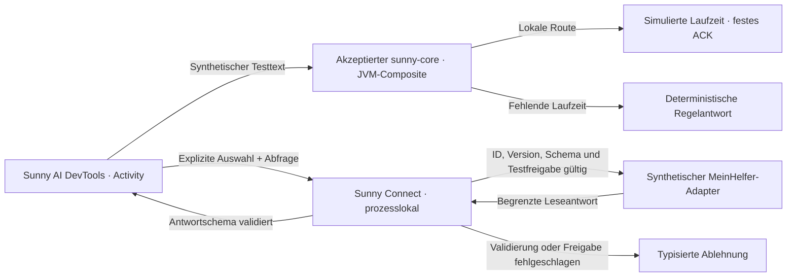

# POC-S1 – Sunny Standalone & Connect

Sunny AI DevTools ist eine eigenständige experimentelle Android-App für einen lokalen Test mit synthetischen Eingaben. Die Quellbasis ist GitHub-Commit 45fe34dc5b7bc513885712563c8c00311f86ae0a auf entwicklung/sunny-2. Gegenüber fd6f4ac enthält diese Basis sechs Dokumentationscommits. Der Arbeitsbranch ist codex/sunny-standalone-poc.

Die [Bestandsaufnahme](INVENTORY.md) dokumentiert vorhandene Fähigkeiten, Datenhoheit, Abhängigkeiten, Berechtigungen und ihre Zielzuordnung gemäß den Produktprinzipien. MeinHelfer bleibt eigenständig nutzbar.

## Architektur



Der Composite-Build substituiert de.meinhelfer.sunny:sunny-core:0.1 mit dem unveränderten Gradle-Projekt im Nachbarverzeichnis. Kotlin-Standardbibliothek und Core bilden die Laufzeitabhängigkeiten. JUnit 4.13.2 dient den Tests. Die App verwendet native Android-Views.

Der Textpfad führt ausschließlich zum SunnyOrchestrator. Die Demo wählt für Sprache die lokale Route mit einem festen ACK. Der zweite Modus setzt dieselbe Route und lässt die Runtime aus, damit der Core seinen ModelMissing-Fallback liefert. Die Ausgabe zeigt feste Texte und den Status. Das Core-Routing erhält seine Offline-Standardwerte, und der Core verwendet seine Standard-Aktionspolicy.

Die Activity hält Testtext, Antworten und Freigaben im Arbeitsspeicher. Eine neue Activity startet ohne Testfreigaben. Die App deaktiviert Backup und für das Eingabefeld Autofill, Zustandswiederherstellung sowie ab Android 10 Content Capture. Über das Editor-Flag bittet sie die Tastatur, den Testtext nicht zum personalisierten Lernen zu verwenden. Die Oberfläche enthält einen Textplatzhalter für den Avatar. Sie verlinkt oder verpackt keine Originalmedien.

## Prozesslokaler Vertrag v1

| Stabile ID | Besitzer | Eingabe | Ausgabe | Testfreigabe |
| --- | --- | --- | --- | --- |
| meinhelfer.today.tasks | MeinHelfer, simuliert | TodayV1 | TodayTasksV1, Liste aus Titel und Erledigt-Status | ReadTodayTasks |
| meinhelfer.today.appointments | MeinHelfer, simuliert | TodayV1 | TodayAppointmentsV1, Liste aus Uhrzeit und Titel | ReadTodayAppointments |

Beide Deskriptoren verwenden Version 1, die Sensitivität Synthetic, den Offline-Status true, Hilfetext und eine leere Abhängigkeitsliste. TodayV1 akzeptiert genau day=today und limit mit einer ASCII-Ziffer von 1 bis 5. „Heute“ bezeichnet einen festen Beispieltag. Beide Ausgaben sind typisierte Listen mit höchstens der angefragten Anzahl an Einträgen und stammen aus fest codierten, begrenzten Werten. Die Demooberfläche fragt jeweils maximal drei Einträge ab.

Der Katalog lehnt doppelte IDs bereits beim Aufbau ab. Der Transport prüft ID, exakte Version, Eingabeschema und sitzungsgebundene Testfreigabe vor dem Aufruf des Adapters. Anschließend prüft er Antworttyp und Anzahl. Explizite Auswahl und manuelle Freigabe gelten pro Deskriptor. Widerruf und Reset sperren nachfolgende Abfragen. Modelltexte erreichen diesen Pfad auch bei aktiver Testfreigabe nicht.

## Manuelle Abnahme durch den Projektverantwortlichen

1. Entwicklungs-APK auf einem Testgerät zusätzlich zu MeinHelfer und, falls vorhanden, MeinHelfer DevTools installieren. Paket, App-Start und getrennte Datenbereiche prüfen.
2. Im Flugmodus die App öffnen. Testtext eingeben, feste Bestätigung und bei simulierter fehlender Laufzeit die feste Regelantwort prüfen. Hilfe öffnen.
3. „Aufgaben heute“ ohne Freigabe abfragen. Ablehnung prüfen, Testfreigabe erteilen und die festen Aufgaben lesen. „Termine heute“ auswählen und die unabhängige Ablehnung prüfen. Freigeben und die festen Termine lesen.
4. Testfreigabe der Auswahl widerrufen und erneut abfragen. Sitzung zurücksetzen und prüfen, dass Testtext, Ergebnisse und beide Freigaben gelöscht sind.
5. MeinHelfer separat öffnen und die bisherige Funktion und Daten prüfen. Ergebnis mit Gerät, Android-Version und APK-Prüfsumme in Chat 00 festhalten.

## Folgepakete und Rollback

Sunny kann zuerst app-unabhängige Regeltexte, Darstellung und lokales Hilferouting auf Basis stabiler, testbarer Verträge übernehmen. Für MeinHelfer bieten sich begrenzte, lesende Tagesdaten als erster Modulvertrag an. Voraussetzungen sind ein von MeinHelfer kontrollierter Zugriff, versionierte DTOs, geringstmöglicher Datenumfang, durchgesetzte Freigabe und Widerruf und ein Nachweis, dass der Host ohne Sunny wie bisher nutzbar bleibt.

Für die Übernahme einer Modul-Fähigkeit in Sunny gelten nachgewiesene App-Unabhängigkeit, typisierte und versionierte Verträge, definierte Dateneigner und Berechtigungen, unabhängige Tests für Offline-Betrieb, Ablehnung und Widerruf sowie getrennte Freigabe durch den Projektverantwortlichen. Berechtigungen müssen eigenständig und ausdrücklich erteilt werden.

App-übergreifendes IPC, Paketidentität/-signatur als Autorisierungsgrenze, echte Berechtigungsfreigaben, Modellimport und Inferenz, persistentes Gedächtnis, TTS, Avatar-Animation, Pflegedaten und produktive Extraktion liegen in separat freizugebenden Paketen. POC-Testfreigaben haben keine Wirkung außerhalb der Activity.

Ein Rollback auf dem Arbeitsbranch erfolgt per git revert des POC-Commits. Die separate App kann über die Android-Testgeräteverwaltung deinstalliert werden. Eine Daten- oder Schemarückmigration entfällt. Lokale Build-Ausgaben und ein separat erzeugter Testschlüssel gehören nicht zum Git-Stand.

## Build- und Prüfnachweis am 27.11.2026

Linux amd64 mit Temurin Java und javac 17.0.17, Gradle 8.11.1, Kotlin-Plugin 2.2.21 und AGP 8.10.1. SDK Platform Android 15/API 35, Revision 2, und Android Build Tools 35.0.0 wurden anhand der installierten Paketmetadaten und des APK-Manifests bestätigt. compileSdk und targetSdk sind 35, minSdk ist 26. Für eine Wiederholung werden ein Android-SDK mit diesen Paketen, JDK 17, Gradle 8.11.1 und beim ersten Build Zugriff auf die Gradle/Maven-Repositories benötigt. Der folgende Abschlusslauf nutzte den zuvor gefüllten Cache.

```bash
cd /workspace/work/poc-s1-repo
source /workspace/.mein-helfer-android/activate.sh
java -version
javac -version
gradle --version
gradle -p sunny-core --no-daemon --max-workers=4 clean test

export ANDROID_HOME=/workspace/work/poc-s1-sdk
export ANDROID_USER_HOME=/workspace/work/poc-s1-home/.android
mkdir -p "$ANDROID_USER_HOME"
gradle -Duser.home=/workspace/work/poc-s1-home \
    '-Dorg.gradle.jvmargs=-Xmx1536m -Dfile.encoding=UTF-8 -Duser.home=/workspace/work/poc-s1-home' \
    -p sunny-standalone-poc --offline --no-daemon --max-workers=4 \
    clean testDebugUnitTest assembleDebug dependencies --configuration debugRuntimeClasspath

tools="$ANDROID_HOME/build-tools/35.0.0"
apk=sunny-standalone-poc/build/outputs/apk/debug/sunny-standalone-poc-debug.apk
"$tools/aapt" dump badging "$apk"
"$tools/aapt" dump permissions "$apk"
"$tools/aapt" dump xmltree "$apk" AndroidManifest.xml
"$tools/apksigner" verify --verbose --print-certs "$apk"
"$tools/zipalign" -c -P 16 4 "$apk"
sha256sum "$apk"
git diff --check 45fe34dc5b7bc513885712563c8c00311f86ae0a
git diff --name-status 45fe34dc5b7bc513885712563c8c00311f86ae0a
```

| JUnit-XML-Berichte | Bestanden | Fehlgeschlagen | Fehler | Übersprungen |
| --- | ---: | ---: | ---: | ---: |
| sunny-core/build/test-results/test, Routing 96, Orchestrator 14, Runtime 21 | 131 | 0 | 0 | 0 |
| sunny-standalone-poc/build/test-results/testDebugUnitTest, Connect 12, Core-Demo 4 | 16 | 0 | 0 | 0 |
| Gesamt | 147 | 0 | 0 | 0 |

Debug-APK im Cloud-Checkout unter /workspace/work/poc-s1-repo/sunny-standalone-poc/build/outputs/apk/debug/sunny-standalone-poc-debug.apk. Größe 900830 Byte. SHA-256 des geprüften Builds **b4f99c84ead2787d6ab0a95ebfdfe7d16d70e3f6d5e065921addc3f7a87864dc**. Die APK liegt im Build-Verzeichnis des Cloud-Checkouts und wird weder mit dem Quellcode eingecheckt noch als Release bereitgestellt. Ein neuer lokaler Debug-Schlüssel kann zu einer anderen APK-Prüfsumme führen.

Die gepackte Manifestprüfung mit aapt bestätigte den Namen Sunny AI DevTools, das Paket de.meinhelfer.sunny.poc, Debug-Modus, deaktiviertes Backup und exakt eine exportierte Start-Activity de.meinhelfer.sunny.poc.MainActivity mit MAIN/LAUNCHER. Die Berechtigungsausgabe enthält nur die Paketzeile. Es gibt keine Services, Receiver, Provider, Paketabfragen, gemeinsam genutzte UID oder HOME-Rolle. Der Quellvergleich der Paket-IDs enthält de.meinhelfer.tag und de.meinhelfer.tag.lab als getrennte bestehende Identitäten. Die Prüfung gilt für den Code und die APK aus diesem Repository.

apksigner bestätigte eine gültige APK-v2-Signatur mit genau einem Android-Debug-Zertifikat. AGP erzeugte den Schlüssel für diesen POC im separaten Android-Benutzerverzeichnis. Der Zertifikatfingerabdruck (SHA-256) ist 9b8297f36eed1a72c3e47665aaf24c6d28da23adc4a2d23487dce4c195fa08c9. zipalign war erfolgreich. dexdump über alle classes*.dex bestätigte die verpackte SunnyOrchestrator-Klasse und die POC-Klassen. Das APK-Archiv enthält keine MeinHelfer-Produktionsklassen, nativen Bibliotheken, Modell- oder Medien-Assets.

| Kriterium | Nachweis und Status |
| --- | --- |
| P01 | Eigenständiger Clean Build und 131 Core-Tests mit der verifizierten Toolchain. |
| P02 | Git-Diff enthält nur neue Dateien unter sunny-standalone-poc/. Bestehende App-Quellen, Core, Schema-Quellstand und Build-Konfiguration entsprechen der Basis. Das in älteren Berichten erwähnte unversionierte Room-Schema liegt im frischen Checkout nicht vor. Der POC-Build startet keine App- oder Schema-Aufgaben. |
| P03 | aapt prüfte das gepackte Manifest. Eine einzige Start-Activity und null Berechtigungen. Paket und neue Debug-Signatur geprüft. |
| P04 | Core-Orchestrator ist im APK enthalten. Die Integrationstests prüfen feste Simulation, validierte Eingaben und deterministischen Fallback. Die UI kennzeichnet Simulation und Testdaten. |
| P05 | Tests prüfen doppelte IDs, unbekannte IDs, inkompatible Version, fehlerhafte Anfragen und fehlende Freigaben. Spy bestätigt null Adapteraufrufe bei diesen abgelehnten Anfragen. |
| P06 | Tests prüfen beide typisierten Antworten, Limits, getrennte Freigaben, Widerruf und Reset. Ein Modellvorschlag erreicht auch bei aktiver Freigabe den Adapter nicht. |
| P07 | Quell- und APK-Prüfung für die isolierte Demo. Testtext bleibt im flüchtigen UI/Core-Aufruf. Es gibt keine App-eigene Speicherung, Protokollierung, Netzwerk-, Host- oder Datenbankpfade, Übernahme von Zugangsdaten oder dynamische Codeausführung. |
| P08 | 147 bestandene Tests und null Fehler, Fehlschläge oder Übersprünge. APK-Pfad, Prüfsumme, Toolchain und Manifestprüfung sind dokumentiert. |
| P09 | GitHub-Übergabe als Draft PR. Installation, Start im Flugmodus und Parallelinstallation mit Datentrennung sind für die Abnahme auf dem Gerät offen. Die bestehenden CI-Pfadfilter erfassen das POC-Verzeichnis nicht. Der unabhängige Android-Build und das Review stehen aus. |
| P10 | Bestandsaufnahme und Folgepakete ordnen allgemeine Fähigkeiten Sunny und App-spezifische Fähigkeiten dem MeinHelfer-Modul zu. Übernahme folgt den dokumentierten Prüfkriterien und der separaten Freigabe. |

## Geänderte Dateien

Alle elf Dateien liegen unter sunny-standalone-poc/.

| Pfad | Zweck |
| --- | --- |
| settings.gradle.kts, build.gradle.kts | Eigenständiger Android-Debug-Build und Core-Composite |
| src/main/AndroidManifest.xml, src/main/res/values/styles.xml | Eigenes Paket, Start-Activity, Label und Theme |
| src/main/kotlin/de/meinhelfer/sunny/poc/MainActivity.kt | Experimentelle Offline-Oberfläche |
| src/main/kotlin/de/meinhelfer/sunny/poc/CoreDemo.kt | Core-Aufruf mit fester Runtime oder Fallback |
| src/main/kotlin/de/meinhelfer/sunny/poc/MockConnect.kt | Deskriptor, Katalog, Freigaben, Transport und Testadapter |
| src/test/kotlin/de/meinhelfer/sunny/poc/CoreDemoTest.kt | Core-Integration und Trennung von Modelltext und Capability-Aufruf |
| src/test/kotlin/de/meinhelfer/sunny/poc/MockConnectTest.kt | Schema-, Freigabe-, Widerrufs- und Adaptertests |
| INVENTORY.md, README.md | Bestand, Zuordnung und Prüfnachweis |
