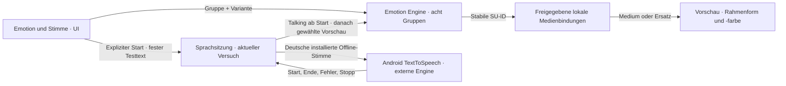

# POC-S2 – Sunny Emotion & Voice v0.2

Umsetzung zum freigegebenen Ausgangscommit 35d1b36797962ef50c4b02885c92573fd3d55605 auf entwicklung/sunny-2. Seit dem S1-Merge 6b0dedc4685d72c4c7bac960cf5861a415511996 enthält die Basis drei reine Dokumentationscommits. Der Arbeitsbranch ist codex/sunny-standalone-s2. Die App führt weiterhin den simulierten Core und den prozesslokalen Connect-Demoablauf mit synthetischen Daten aus.

## Architekturentscheidungen



- **Emotion.** Die Reihenfolge der IDs innerhalb aller acht Gruppen entspricht MeinHelfers SunnyEmotionMedia.kt auf der Basis. Die Variantenwahl läuft deterministisch durch die gewählte Gruppe. Weitere IDs ab su36 lassen sich den Gruppen anhängen. Doppelte und reservierte Erweiterungs-IDs werden abgewiesen.
- **Medien.** Der Katalog verwendet eine kompilierte Liste freigegebener Ressourcen und kanonische Dateinamen wie su05.webp und su05.mp4. Unbekannte IDs, ungültige Namen und mehrdeutige Bild- oder Videobindungen werden verworfen. Bildmodus verwendet das zugehörige Bild. Videomodus versucht das Video unter derselben ID und fällt bei fehlendem oder fehlerhaftem Video auf das Bild oder den Platzhalter zurück. Automatik berücksichtigt die Android-Systemeinstellung für Animationen. Lokale Videos sind stumm und belegen keinen Audiofokus. Vorschauclips spielen einmal, eine Sprechvariante kann bis zum Ende der Sprachausgabe wiederholen. Das Verhalten mit echten Medien braucht eine spätere Geräteprüfung.
- **Stimme.** Aus der Android-Engine werden installierte deutsche Stimmen ausgewählt, deren Metadaten keine Netzwerkverbindung verlangen. de-DE hat Vorrang. Die App prüft die gesetzte Stimme erneut vor speak(). Sie hat keinen Download- oder Online-Ersatzpfad. Fehlende Stimme, fehlende Engine, Zeitüberschreitung und Fehler führen zu Status plus sichtbarem synthetischem Text. Androids TTS-Engine ist eine externe Vertrauensgrenze. Geprüft wird die Auswahl anhand der von ihr gelieferten Metadaten. Die App übergibt nur eine von zwei fest codierten Testphrasen.
- **Synchronisation.** onStart wechselt auf Talking (SU30). Ende, Fehler und Stopp stellen die gewählte Ruhevariante wieder her. Die Zustandsmaschine und der Android-Adapter ignorieren Rückmeldungen aus abgelösten Versuchen. Stopp, Reset und Verlassen des Vordergrunds beenden die Ausgabe und geben die TTS-Instanz frei. Die Kopplung erfolgt über Wiedergabeereignisse.
- **Gestaltung und Sitzung.** Rahmenform, Rahmenfarbe und Darstellungsmodus gelten für die laufende Testsitzung. Der bisherige Reset löscht weiterhin Eingabe, Ergebnisse und Testfreigaben. Er beendet zusätzlich die Sprachausgabe und setzt die Vorschau und Gestaltung auf ihre Startwerte. Paket, Backup-Einstellung, Manifest und Signierkonfiguration bleiben auf dem Stand von S1. Der APK-Versionscode ist 2, der Versionsname 0.2-poc.

## Offene Medien- und Geräteevidenz

Die autoritativen Archive Sunny_Emotion_Medien_png.zip und Sunny_Emotion_Medien_optimiert_Webp.zip wurden für diesen Stand nicht bereitgestellt. Der Katalog für die ausgelieferte App ist leer. Die Vorschau zeigt in allen drei Modi den Text „Avatar-Platzhalter“ und die aktuelle Emotions-ID. Quellnachweis, Rechte, Zuordnung, Größen und Prüfsummen der Originalmedien bleiben offen. Die von MeinHelfer verwendeten älteren Bild- und Videodateien wurden nicht übernommen.

Auf Android 11+ kann die Entdeckung der TTS-Engine vom Paket-Sichtbarkeitsfilter abhängen. Die App enthält gemäß Freigabe keine Manifest-Queries. Ob der verfügbare deutsche Offline-Stimmendienst auf dem Abnahmegerät erreichbar ist, bleibt zu prüfen. Bei fehlender Sichtbarkeit bleibt der synthetische Text sichtbar. Wenn die Plattformprüfung eine Manifest-Query für TTS_SERVICE erfordert, braucht diese zusammen mit der bestehenden CI-Isolationsprüfung eine eigene Freigabe.

Die S1-Geräteabnahme bleibt als historischer Nachweis in [DEVICE-ACCEPTANCE.md](DEVICE-ACCEPTANCE.md). Für S2 stehen Geräteprüfungen und die Signaturkontinuität für ein In-place-Update aus. Der Signaturfingerabdruck der installierten S1-APK wurde in der Geräteabnahme nicht erhoben. Für die Update-Strategie sind vor einem Installationsversuch der Fingerabdruck der installierten S1-APK oder eines genau zugeordneten Referenzartefakts und derjenige des S2-Builds zu vergleichen. Bei abweichendem Zertifikat bleibt die installierte App bestehen. Während S2 wurde in de46bac die separate Signaturstrategie für die dauerhafte DevTools-Identität de.meinhelfer.sunny.devtools dokumentiert. Die koordinierte Umsetzung folgt nach dem S2-Review. Die erste Installation dieser Identität ist separat vorgesehen. [DevTools-Signaturstrategie](https://github.com/Sunshinerene/Mein-Helfer-f-r-den-Tag/blob/de46bac8dfcbe01063b8047d3fb9d331456de816/docs/SUNNY-DEVTOOLS-SIGNING.md)

### Prüfschritte nach Freigabe der Testinstallation

1. Signaturkontinuität für das vorgesehene Testgerät prüfen. Prüfsumme, Geräte-/Android-Version und APK-Herkunft festhalten.
2. Im Flugmodus einen festen Testtext starten. Auf die Anzeige von „Sprechend · SU30“ während der Ausgabe achten. Bei Ende, Stopp, Reset und Wechsel der App die Ruhevariante und das Ende der Ausgabe prüfen. Falls keine Stimme verfügbar ist, den sichtbaren Text und den Status erfassen.
3. Alle Darstellungsmodi, den Variantenwechsel und die Rahmenoptionen prüfen. Für die getrennte Medienabnahme nach Bereitstellung der Originale die Zuordnung, stille Wiedergabe und den Rückfall bei fehlendem Video auf dem Gerät prüfen.
4. Die S1-Abläufe aus DEVICE-ACCEPTANCE.md für die neue APK wiederholen. MeinHelfer separat öffnen und bestehende Daten und Funktionen prüfen.

## Rollback

Den S2-Commit bei Bedarf auf dem Arbeitsbranch per git revert zurücknehmen. App-Daten, Speicherformat und Host-Schnittstellen verwenden keine Migration. Für einen Build-Rollback auf dem Gerät gelten die Android-Regeln für Zertifikatgleichheit und Versionscodes. Eine installierte S1-App bleibt bis zur abgestimmten Update-Strategie bestehen.

## Build und Prüfung am 27.11.2026

Linux amd64, Temurin Java/javac 17.0.17, Gradle 8.11.1, Kotlin-Plugin 2.2.21, Android Gradle Plugin 8.10.1. Installiert sind Android 15/API 35 Revision 2 und Build Tools 35.0.0. compileSdk und targetSdk sind 35, minSdk ist 26. Die Läufe nutzten vorhandene Toolchain- und Gradle-Caches. Der Kern- und Basistestlauf erfolgten vor den Änderungen auf der verifizierten Integration. Der abschließende Clean Build prüfte erneut alle POC-Tests und das Debug-APK.

```bash
cd /workspace/work/poc-s2-repo
source /workspace/.mein-helfer-android/activate.sh
export ANDROID_HOME=/workspace/work/poc-s1-sdk
export ANDROID_USER_HOME=/workspace/work/poc-s2-home/.android
mkdir -p "$ANDROID_USER_HOME"
java -version
javac -version
gradle --version
gradle -p sunny-core --offline --no-daemon --max-workers=4 clean test
gradle -Duser.home=/workspace/work/poc-s2-home \
    '-Dorg.gradle.jvmargs=-Xmx1536m -Dfile.encoding=UTF-8 -Duser.home=/workspace/work/poc-s2-home' \
    -p sunny-standalone-poc --offline --no-daemon --max-workers=4 clean testDebugUnitTest
gradle -Duser.home=/workspace/work/poc-s2-home \
    '-Dorg.gradle.jvmargs=-Xmx1536m -Dfile.encoding=UTF-8 -Duser.home=/workspace/work/poc-s2-home' \
    -p sunny-standalone-poc --offline --no-daemon --max-workers=4 \
    clean testDebugUnitTest assembleDebug dependencies --configuration debugRuntimeClasspath

tools="$ANDROID_HOME/build-tools/35.0.0"
apk=sunny-standalone-poc/build/outputs/apk/debug/sunny-standalone-poc-debug.apk
"$tools/aapt" dump badging "$apk"
"$tools/aapt" dump permissions "$apk"
"$tools/aapt" dump xmltree "$apk" AndroidManifest.xml
"$tools/apksigner" verify --verbose --print-certs "$apk"
"$tools/zipalign" -c -P 16 4 "$apk"
sha256sum "$apk"
git diff --check 35d1b36797962ef50c4b02885c92573fd3d55605
git diff --name-status 35d1b36797962ef50c4b02885c92573fd3d55605
```

| JUnit-XML-Suite | Bestanden | Fehlgeschlagen | Fehler | Übersprungen |
| --- | ---: | ---: | ---: | ---: |
| Sunny Core (Routing 96, Orchestrator 14, Runtime 21) | 131 | 0 | 0 | 0 |
| POC-S1 im Abschlusslauf (Core-Demo 4, Connect 12) | 16 | 0 | 0 | 0 |
| POC-S2 im Abschlusslauf (Emotion 9, Stimme 11) | 20 | 0 | 0 | 0 |
| Gesamt | 167 | 0 | 0 | 0 |

Die POC-S1-Tests und ihre Quellen sind identisch mit der Basis. Die JUnit-XML-Verzeichnisse sind sunny-core/build/test-results/test und sunny-standalone-poc/build/test-results/testDebugUnitTest. Der Runtime-Classpath enthält weiterhin das Core-Composite, Kotlin 2.2.21 und transitive JetBrains-Annotationen 13.0. dexdump bestätigte Core, Connect, Emotion Engine und Voice-Adapter im APK und fand keine MeinHelfer-Produktionsklassen.

**APK im Cloud-Checkout** /workspace/work/poc-s2-repo/sunny-standalone-poc/build/outputs/apk/debug/sunny-standalone-poc-debug.apk, 937832 Byte. SHA-256 **3d63fca3715b3b7b34cdbc7ac1389c03ae1f9412fdb67255c1ef6ca30f2c8569**.

aapt bestätigte de.meinhelfer.sunny.poc, v0.2-poc, minSdk 26, targetSdk und compileSdk 35, Debug-Modus, allowBackup=false und ausschließlich die einzige MAIN/LAUNCHER-Activity. Die Berechtigungsausgabe enthält nur die Paketzeile. Das gepackte Manifest enthält keine Queries, weiteren Komponenten, gemeinsame UID oder HOME-Kategorie. Das APK-Archiv enthält keine Medien, Modelle oder nativen Bibliotheken. zipalign war erfolgreich.

apksigner bestätigte eine gültige APK-v2-Signatur mit genau einem Android-Debug-Zertifikat. SHA-256 des Zertifikats **393546c95b4a8379a7acee842cd6274db1e17eba2ff6dd9011023832f11d808b**. Der Standard-Debug-Build hat einen lokalen Schlüssel im separaten Android-Benutzerverzeichnis erzeugt. Das S1-CI-Referenzartefakt ist auf GitHub verzeichnet. Der Zugriff auf die ZIP-Datei aus der Cloud-Umgebung wurde mit HTTP 403 abgewiesen. Die Kontinuität zum Zertifikat der installierten S1-APK bleibt offen. Es wurde kein Installationsversuch unternommen. [S1-CI-Artefakt](https://github.com/Sunshinerene/Mein-Helfer-f-r-den-Tag/actions/runs/45981591325/artifacts/15190116172)

## Kriterien S201–S209

| Kriterium | Status und Nachweis |
| --- | --- |
| S201 | Erfüllt im Cloud-Build. Standalone-Build und unveränderte 131 Core- und 16 S1-Tests erfolgreich. |
| S202 | Erfüllt in automatisierten Tests. Alle 35 IDs, acht geordnete Gruppen, Variantenwechsel, Erweiterung, fehlende und ungültige Medienbindungen sowie Ersatzpfade. |
| S203 | Erfüllt in automatisierten Tests. Auswahl anhand von Offline-/Installationsmerkmalen, Text-Ersatz bei Unverfügbarkeit/Fehler, Start/Ende/Stopp, Wiedereinstieg, veraltete Rückmeldungen und Reset mit Fake-Engine. Tatsächliche Android-Ausgabe siehe S207. |
| S204 | Erfüllt in APK- und Diff-Prüfung. Gleiches Paket, keine Berechtigungen oder zusätzlichen Komponenten, keine Queries, Backup aus, kein Netzwerkpfad im POC. |
| S205 | Offen. Gekennzeichneter neutraler Platzhalter umgesetzt. Autoritative Medien, Freigabe, Inventar, Größen und Hashes fehlen. |
| S206 | Erfüllt im Cloud-Build. 167/167 ohne Fehler, Fehlschläge oder übersprungene Tests. APK, Prüfsumme, Toolchain, Manifest, Diff, Grenzen und Rollback dokumentiert. |
| S207 | Offen. Offline-Sprache, sichtbarer Emotionswechsel, Stopp/Reset, S1-Ablauf und unveränderte MeinHelfer-Nutzung müssen auf dem Gerät abgenommen werden. Die TTS-Engine-Sichtbarkeit ist geräteabhängig. |
| S208 | Offen. Debug-Fingerabdruck dokumentiert, Signaturkontinuität zum installierten S1 und Update-Strategie ausstehend. |
| S209 | Übergabe als Draft PR auf codex/sunny-standalone-s2. Die Ausführung enthält keinen Release, Merge, Sunny-Connect-IPC oder Modellruntime-Wechsel. Der bestehende S1-Workflow startet für diesen Branch nicht automatisch. Unabhängige CI und Review sind für die Abnahme noch offen. |

## Geänderte Dateien

Alle folgenden Pfade sind relativ zu sunny-standalone-poc/. Der Vergleich mit der Basis bestätigt unveränderte MeinHelfer-, Core-, Sicherheits-, Manifest- und Workflow-Dateien.

| Pfad | Zweck |
| --- | --- |
| build.gradle.kts | Versionscode 2 und Versionsname 0.2-poc |
| src/main/kotlin/de/meinhelfer/sunny/poc/MainActivity.kt | Einbindung des Panels, Vordergrund-Lebenszyklus, Hilfe und gemeinsamer Reset |
| src/main/kotlin/de/meinhelfer/sunny/poc/EmotionVoicePanel.kt | Vorschau, Bild/Video/Automatik, Gestaltung und Sprachbedienung |
| src/main/kotlin/de/meinhelfer/sunny/poc/emotion/EmotionEngine.kt | Stabile IDs, Gruppen, Variantenauswahl, Medienkatalog und Ersatzpfade |
| src/main/kotlin/de/meinhelfer/sunny/poc/emotion/AvatarPreview.kt | Platzhalter, Rahmen und Renderpfade für freigegebene lokale Medien |
| src/main/kotlin/de/meinhelfer/sunny/poc/voice/VoiceSession.kt | Feste Phrasen, Stimmenwahl und Zustandsmaschine |
| src/main/kotlin/de/meinhelfer/sunny/poc/voice/AndroidVoiceOutput.kt | Android-TTS, Ereignisse, Zeitgrenzen und Freigabe der Instanz |
| src/test/kotlin/de/meinhelfer/sunny/poc/emotion/EmotionEngineTest.kt | Vertrags- und Medientests |
| src/test/kotlin/de/meinhelfer/sunny/poc/voice/VoiceSessionTest.kt | Stimmenwahl, Fake-Engine und Ereignissynchronisation |
| README.md, S2-REPORT.md | Verweis und Prüfnachweis |
